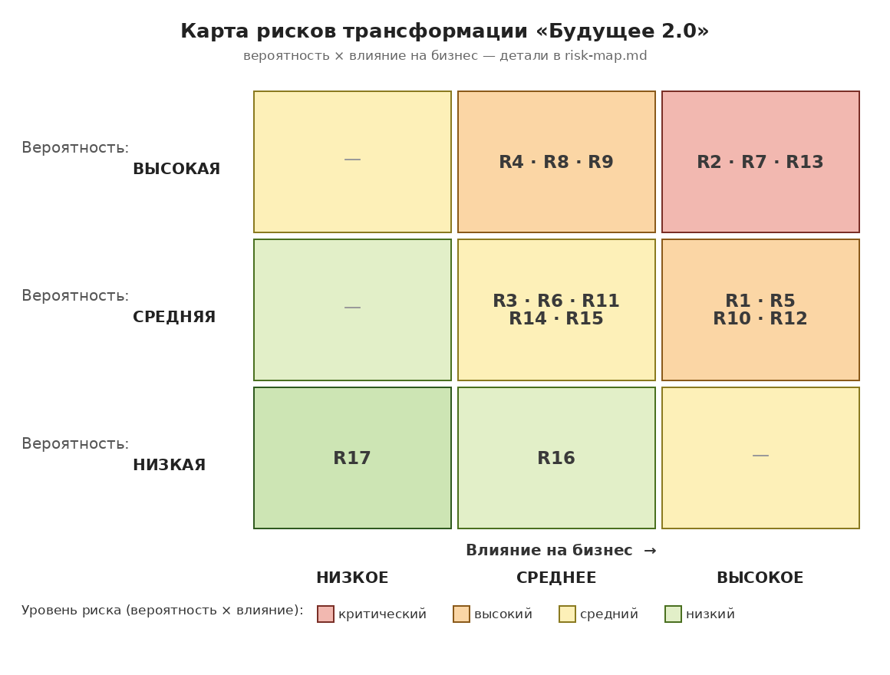

# Карта рисков трансформации «Будущее 2.0»

Карта покрывает три года трансформации к событийной платформе: пилот (0–6 мес.), развёртывание (6–18 мес.), вывод легаси и масштабирование (18–36 мес.).

## Как оценивались

- **Вероятность** - вероятность наступления в горизонте 3 лет: низкая / средняя / высокая.
- **Влияние на бизнес** - последствия, если риск наступит: низкое / среднее / высокое.
- **Уровень риска** - комбинация двух оценок (легенда цветов на теплокарте):
  красный - критический (высокая вероятность, высокое влияние), оранжевый - высокий, жёлтый - средний, зелёный - низкий.
- Оценка сделана архитектурной командой с владельцами доменов (финтех, клиники, ИИ, банк); пересматривается каждые 2 недели (см. risk-management-plan.md).

## Архитектурные риски

| # | Риск | Вероятность | Влияние | Уровень |
|---|------|:-----------:|:-------:|:-------:|
| R1 | Неправильная модель событий и схем: доменные границы и контракты событий определены неверно, при подключении нового домена потребуются изменения в ядре шины, «событийный долг» | средняя | высокое | высокий |
| R2 | Витрина не воспроизводит легаси-отчётность (Power BI поверх DWH) по охвату и точности: бизнес не доверяет новым числам, остаётся на старых отчётах | высокая | высокое | критический |
| R3 | Неконтролируемый рост потока событий и хранения: сотни ТБ уходят в поток, расходы на Kafka, ClickHouse и storage превышают план | средняя | среднее | средний |
| R5 | Потеря бизнес-логики при выводе DWH/ESB: логика зашита в представления, хранимые процедуры и Camel-маршруты, не задокументирована и не переносится | средняя | высокое | высокий |
| R6 | Свежесть данных ниже ожиданий: near real-time не достигается на критичных срезах, фактический SLA - минуты/часы вместо секунд | средняя | среднее | средний |
| R17 | Переусложнение: событийная платформа оказывается избыточной для текущего объёма, стоимость не окупается даже с учётом планов масштабирования | низкая | низкое | низкий |

## Организационные риски

| # | Риск | Вероятность | Влияние | Уровень |
|---|------|:-----------:|:-------:|:-------:|
| R7 | «Data-silos»: домены (особенно банк после покупки) не готовы отдавать данные и публиковать события, единого владельца данных нет | высокая | высокое | критический |
| R8 | Дефицит компетенций: Kafka, Flink, dbt, потоковая обработка - у единичных специалистов, поставки зависят от конкретных людей | высокая | среднее | высокий |
| R9 | Низкое внедрение витрины: пользователи остаются в Power BI/Excel, портал живёт «для галочки», инвестиции не возвращаются | высокая | среднее | высокий |
| R10 | Регуляторика: пересечение медицинских и финансовых данных, банковская лицензия, data residency в 2–3 новых регионах - требования меняются и тормозят релизы | средняя | высокое | высокий |
| R11 | Размытие фокуса: четыре домена трансформируются одновременно без приоритизации, все направления «критичные» | средняя | среднее | средний |

## Технологические риски

| # | Риск | Вероятность | Влияние | Уровень |
|---|------|:-----------:|:-------:|:-------:|
| R12 | Сбой миграции: cutover от DWH/batch-конвейеров на новую платформу рвёт бизнес-процессы (расчёты, отчёты, интеграции) | средняя | высокое | высокий |
| R13 | Хрупкость легаси: SQL Server 2008 без вендорской поддержки, CDC-мост нестабилен, база знаний DBA уходит вместе с кадрами - сам «мост совместимости» под угрозой | высокая | высокое | критический |
| R14 | Дублирование и порядок событий: дубли, потеря порядка и рассинхронизация реплик дают неконсистентные данные в витрине и складе | средняя | среднее | средний |
| R15 | Перерасход облака: сумма managed Kafka, Flink, ClickHouse и tiered storage выходит за бюджет | средняя | среднее | средний |
| R16 | Vendor lock-in: привязка к конкретным managed-сервисам облака, стоимость переключения высока | низкая | среднее | низкий |

## Что в фокусе

Три критических риска - **R2** (бизнес не получит «свои цифры» на витрине), **R7** (домены не отдадут данные) и **R13** (легаси умрёт раньше, чем закончится миграция). Все три закрываются связкой технических и управленческих мер - раскладка по рискам в [risk-management-plan.md](risk-management-plan.md).
